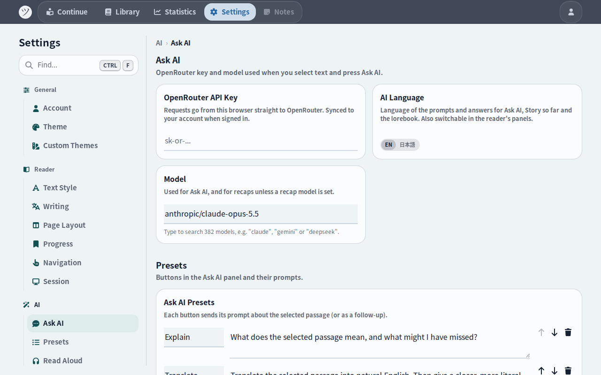
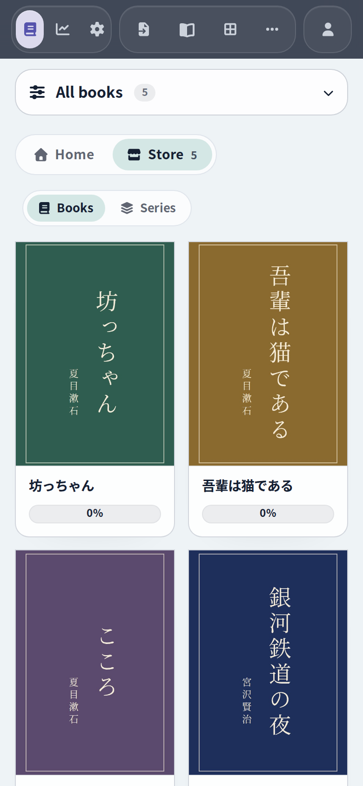
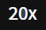
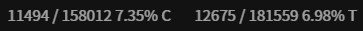

# chimimouryou

A self-hosted Japanese e-book reader for your Calibre library: a fork of
[ッツ Ebook Reader](https://github.com/ttu-ttu/ebook-reader) that turns
the browser-based Japanese e-book reader into a reader for your own server: point
it at a Calibre library and everyone in the house reads from it, with accounts,
synced progress and highlights, and tools for language learners. The reader
itself, and its Yomitan support, are upstream's (see [Using the reader](#using-the-reader)).


| Library                                                       | AI settings                                                       | Phone                                                                     |
| ------------------------------------------------------------- | ----------------------------------------------------------------- | ------------------------------------------------------------------------- |
|  |  |  |

<sub>Books shown: public-domain texts from [青空文庫](https://www.aozora.gr.jp/).</sub>

**What it adds**

- **Your Calibre library** as the bookshelf: covers (extracted from EPUBs that
  have none), series (Calibre's or guessed from volume numbers), tags, a
  Home/Store layout with "Continue reading", filters and sorting. Books open
  straight from the server; adding a file puts it into Calibre.
- **Accounts** with an admin panel and per-account permissions; progress,
  statistics, highlights and settings sync across devices.
- **Highlights and notes**, full-text search (ignoring furigana), and a reader
  companion with your highlights.
- **AI helpers** with your own keys: Ask AI about a selection, "Story so far"
  spoiler-free recaps, a lorebook of characters and places, and an AI voice that
  reads aloud with the current line highlighted. Audiobooks with subtitles follow
  the text too.
- **Manga** (CBZ/ZIP) in a page-turning reader.
- **Difficulty estimates** with [Jiten](https://github.com/Sirush/Jiten)'s
  features and a model trained on jiten.moe's scores, computed on your server.
- **App-wide themes** that follow the system's light and dark mode.

**Run it** (Docker and a Calibre library):

```sh
git clone https://github.com/blankiekun/chimimouryou && cd chimimouryou
cp .env.example .env          # set LIBRARY_PATH, PUID/PGID
docker compose up -d --build
docker compose exec account ebook-account initial-admin   # the first admin's temporary password
```

Then open `http://<server>:8080`. Signing in needs HTTPS: put a reverse proxy in
front (Caddy, Traefik, Tailscale; see the install guide).

**Documentation**

- [docs/INSTALL.md](docs/INSTALL.md): installing, HTTPS, accounts, who may do what
- [docs/CONFIGURATION.md](docs/CONFIGURATION.md): every setting
- [ARCHITECTURE.md](ARCHITECTURE.md): how it works; [CONTRIBUTING.md](CONTRIBUTING.md): changing it
- [docs/QA.md](docs/QA.md): test plan; [CHANGELOG.md](CHANGELOG.md); [themes.md](themes.md): writing themes
- Prebuilt images: `ghcr.io/blankiekun/chimimouryou-{web,services,import,difficulty}` (see INSTALL.md, "Updating")

**Credits**: [ッツ Ebook Reader](https://github.com/ttu-ttu/ebook-reader) by
ッツ Reader Authors (BSD 3-Clause, see [LICENSE](LICENSE)), from which this fork
derives; [Jiten](https://github.com/Sirush/Jiten) for the difficulty features and
deconjugation rules (Apache-2.0, see [NOTICE](NOTICE)). chimimouryou is not
affiliated with or endorsed by either project.

## Using the reader

The reader is upstream's [ッツ Ebook Reader](https://github.com/ttu-ttu/ebook-reader)
(EPUB, HTMLZ and plain text; continuous or paginated, vertical or horizontal; works
with Yomitan and other dictionary extensions). Upstream's
[README](https://github.com/ttu-ttu/ebook-reader#readme) has the full reference:
the reading tracker, statistics, import/export merge modes and setting up your own
GDrive or OneDrive credentials (not needed with the Calibre library).

Click or tap the top of the page to open the reader header:

| Control                                              | Description                                                         |
| ---------------------------------------------------- | ------------------------------------------------------------------- |
|                | Table of contents                                                   |
|           | Bookmark the current position (<kbd>b</kbd>)                        |
|    | Return to the bookmark (<kbd>r</kbd>)                               |
|         | Auto-scroll speed (<kbd>a</kbd>/<kbd>d</kbd>)                       |
|             | Mark the book as finished                                           |
|      | Pick a custom reading point (<kbd>t</kbd>)                          |
|         | Fullscreen (<kbd>F11</kbd>)                                         |
|  | Statistics for this book                                            |
|               | Jump to a character position                                        |
|      | Image gallery                                                       |
|           | Settings                                                            |
|            | Library                                                             |

The footer shows the reading tracker
( paused: double-tap to
start, tap for its menu) and the progress
(, C = chapter, T = book; tap to copy).
Progress counts Japanese characters only, without Latin letters or punctuation.

**Desktop keys** (physical positions, so the same keys on any layout):

| Key                                     | Action                                                   |
| --------------------------------------- | -------------------------------------------------------- |
| <kbd>Space</kbd>                        | Toggle auto-scroll (continuous mode)                     |
| <kbd>a</kbd> / <kbd>d</kbd>             | Auto-scroll faster/slower; paginated: next/previous page |
| <kbd>PageDown</kbd> / <kbd>PageUp</kbd> | Next/previous page                                       |
| <kbd>n</kbd> / <kbd>m</kbd>             | Next/previous chapter                                    |
| <kbd>b</kbd> / <kbd>r</kbd>             | Bookmark / return to bookmark                            |
| <kbd>t</kbd>                            | Custom reading point                                     |
| <kbd>p</kbd> / <kbd>f</kbd>             | Toggle the reading tracker / its freeze position         |
| <kbd>Ctrl</kbd>+<kbd>F</kbd>            | Search the book                                          |

Good to know:

- EPUBs that render wrongly (e.g. unclosed links swallowing the text) may import
  correctly with Settings → Data → "Epub Import Fixes" set to standard or extended.
- Plain-text books are titled after the file name and split into paragraphs at
  。？！」）.
- Books read from the Calibre library come back from the server, but other
  browser data (settings without an account, books imported only into the browser)
  lives in the browser's storage, which the browser may clear when the disk fills
  up. Settings → Data shows whether storage is persistent.
