# chimimouryou

A self-hosted Japanese e-book reader for your Calibre library: a fork of
[ッツ Ebook Reader](https://github.com/ttu-ttu/ebook-reader) that turns
the browser-based Japanese e-book reader into a reader for your own server: point
it at a Calibre library and everyone in the house reads from it, with accounts,
synced progress and highlights, and tools for language learners. The reader
itself, and its Yomitan support, are upstream's.

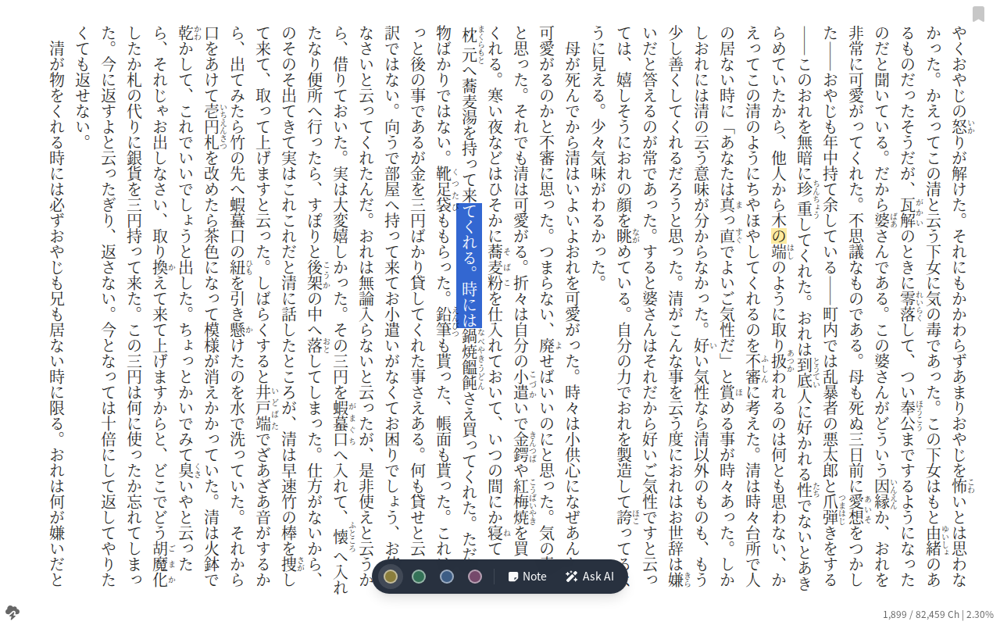

Books, manga and ONScripter visual novels from one library; highlights, search,
audiobooks, AI helpers and Anki mining in the reader; difficulty estimates and
reading statistics for learners. See [Features](#features).

<sub>Screenshots show books from the maintainer's own library; the titles belong to their publishers.</sub>

## Setup

You need [Docker](https://docs.docker.com/get-docker/) with the Compose plugin
(Docker Desktop on Windows and macOS). Prebuilt images exist for amd64 and arm64.

**1. Get it**

```sh
git clone https://github.com/blankiekun/chimimouryou && cd chimimouryou
cp .env.example .env
```

In `.env`, set:

```sh
IMAGE_PREFIX=ghcr.io/blankiekun/chimimouryou   # prebuilt images, nothing to compile
IMAGE_TAG=latest
COMPOSE_PROFILES=import                        # add books from the app
PUID=1000                                      # your `id -u` and `id -g` (Linux)
PGID=1000
```

**2. Choose a library**

- **An existing Calibre library**: point at the folder that holds `metadata.db`
  (quote paths with spaces):

  ```sh
  LIBRARY_PATH="/home/you/Calibre Library"
  ```

  The server adds a `cover.jpg` to book folders without one, and books you add
  in the app go into Calibre. Back the library up first, and close Calibre
  while you add books from the app.

- **A new, empty library**: set `LIBRARY_PATH=./library`, then create it:

  ```sh
  mkdir library
  docker compose run --rm --no-deps import calibredb --with-library /library list
  ```

  After you sign in, add books with Import in the library or by dropping files
  on it. The library is a normal Calibre library, so Calibre can open it later.

**3. Choose how you reach it**

- **Just this computer** (a laptop or desktop): sign in over plain HTTP. The
  port is only open to this machine, so passwords never cross a network.

  ```sh
  HTTP_PORT=127.0.0.1:8080
  ALLOW_HTTP_ACCOUNTS=1
  ```

  Open <http://localhost:8080>.

- **A server** (home server, VPS) for several people or devices: keep
  `ALLOW_HTTP_ACCOUNTS=0` and put HTTPS in front. With
  [Caddy](https://caddyserver.com/) on the same machine (it gets the certificate
  itself), set

  ```sh
  HTTP_PORT=127.0.0.1:8080
  REAL_IP_FROM=172.16.0.0/12      # Docker's network: Caddy's requests come from there
  ```

  and add this to the Caddyfile:

  ```
  books.example.com {
    reverse_proxy 127.0.0.1:8080
  }
  ```

  Open `https://books.example.com`. No domain? `tailscale serve --bg 8080`
  gives an HTTPS address inside your tailnet. Other proxies:
  [docs/INSTALL.md](docs/INSTALL.md#https).

**4. Start it and sign in**

```sh
docker compose up -d
docker compose exec account ebook-account initial-admin
```

The second command shows the password of the first account, `admin`. Sign in
(person icon at the top right), and change the password in Settings → Account.
There is no sign-up: add the other readers in Settings → Account → Admin panel.
The library fills in about a minute after the first start (longer for a big
library, while covers are extracted).

Update with `git pull && docker compose pull && docker compose up -d`. The
[install guide](docs/INSTALL.md) has the rest: trusted networks (reading without
signing in), permissions, backups, difficulty estimates and building the images
yourself.

**Documentation**

- [docs/INSTALL.md](docs/INSTALL.md): installing, HTTPS, accounts, who may do what
- [docs/CONFIGURATION.md](docs/CONFIGURATION.md): every setting
- [ARCHITECTURE.md](ARCHITECTURE.md): how it works; [CONTRIBUTING.md](CONTRIBUTING.md): changing it
- [docs/QA.md](docs/QA.md): test plan; [CHANGELOG.md](CHANGELOG.md); [themes.md](themes.md): writing themes
- Prebuilt images: `ghcr.io/blankiekun/chimimouryou-{web,services,import,difficulty}` (see INSTALL.md, "Updating")

**Credits**: [ッツ Ebook Reader](https://github.com/ttu-ttu/ebook-reader) by
ッツ Reader Authors (BSD 3-Clause, see [LICENSE](LICENSE)), from which this fork
derives; [Jiten](https://github.com/Sirush/Jiten) for the difficulty features and
deconjugation rules (Apache-2.0, see [NOTICE](NOTICE)). chimimouryou is not
affiliated with or endorsed by either project.

## Features

### Library

The Calibre library is the bookshelf. **Home** has your reading at a glance:
characters read today and this week, reading streaks, speed and the number of
different kanji met, then "Continue reading" and "My books". **Store** is the
whole library, as books or as series, with filters (type, reading status, last
read, difficulty, length, tags) and sorting.

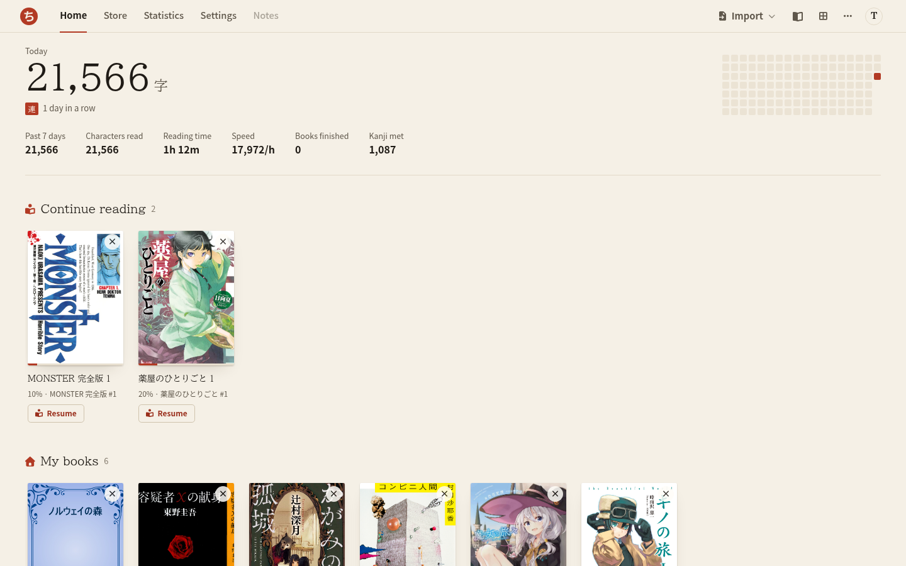

| Store                                                                  | Series                                                                     |
| ---------------------------------------------------------------------- | -------------------------------------------------------------------------- |
| 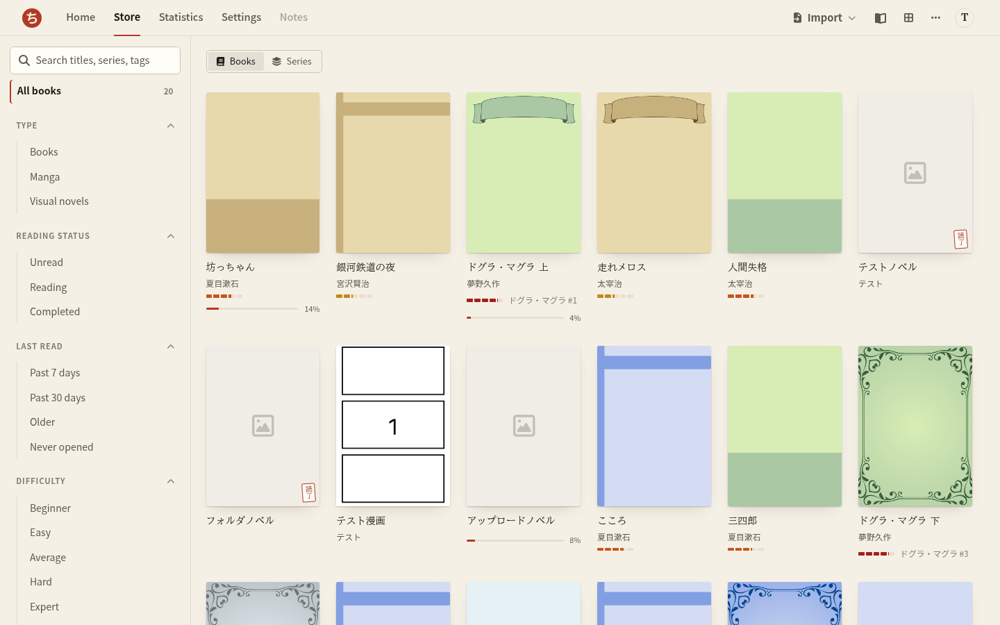 | 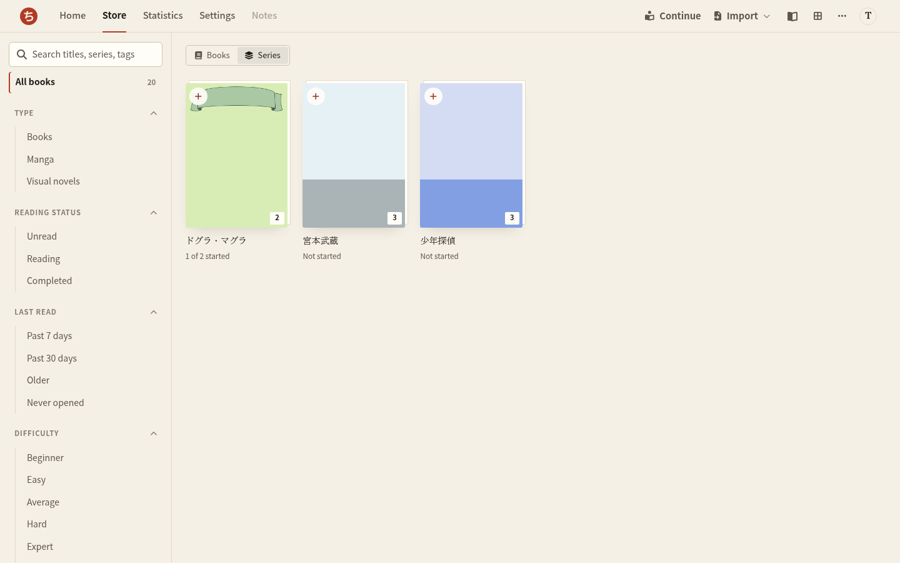 |

- Covers are extracted from EPUBs that have none in Calibre; series come from
  Calibre or are guessed from volume numbers in titles, and readers with the
  `series` permission can group books into series themselves.
- Adding a file (Import, or dropping it on the library) puts it into Calibre.
- Books open straight from the server and stay cached in the browser. Books on
  Home are downloaded in the background, so they can be read offline; progress
  made offline uploads when the server is back.

Clicking a cover opens the book's page: length in characters and the reading
time at your speed, progress, the difficulty estimate, Calibre's metadata and
the rest of the series. "Find details" fills in a description, genres and a
cover from AniList, VNDB or Jiten.

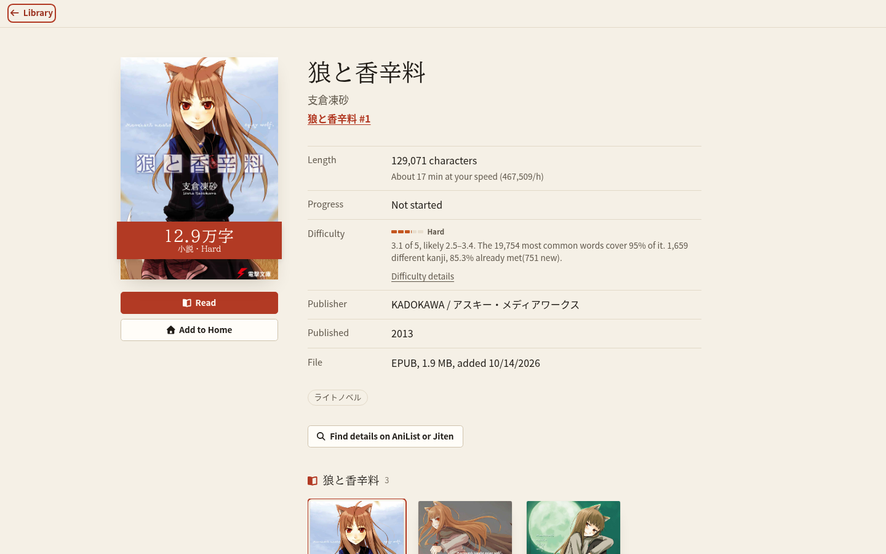

### Reading

The reader is upstream's: EPUB, HTMLZ and plain text, continuous or paginated,
vertical or horizontal, made for [Yomitan](https://yomitan.wraith.wtf/) and
other dictionary extensions. Progress, statistics and settings sync across
devices with your account, with separate reader styles for phones and larger
screens.

- **Highlights and notes** in four colours: select text and pick a colour. The
  reader companion (book icon) lists them by chapter, to jump to, edit, copy or
  download as Markdown.
- **Search** the book (<kbd>Ctrl</kbd>+<kbd>F</kbd>), ignoring furigana, with
  optional kana-insensitive and regular-expression matching.
- **Listen**: an audiobook with SRT/VTT subtitles follows the text and
  highlights the line being read. No subtitles? Whisper can make them in the
  browser. Audiobooks can also come from an
  [Audiobookshelf](https://www.audiobookshelf.org/) server (plugin).
- **Anki mining**: cards made with Yomitan get the sentence's audio from the
  audiobook (or the AI voice) and, in visual novels, a screenshot and the
  line's voice.

| Search                                                              | Highlights                                                                  |
| ------------------------------------------------------------------- | --------------------------------------------------------------------------- |
| 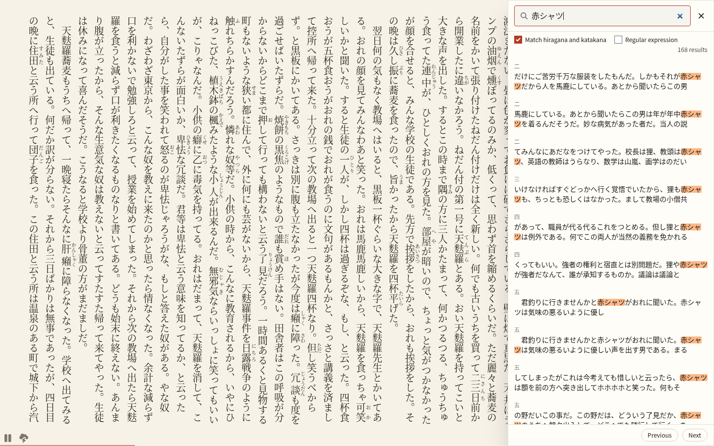 | 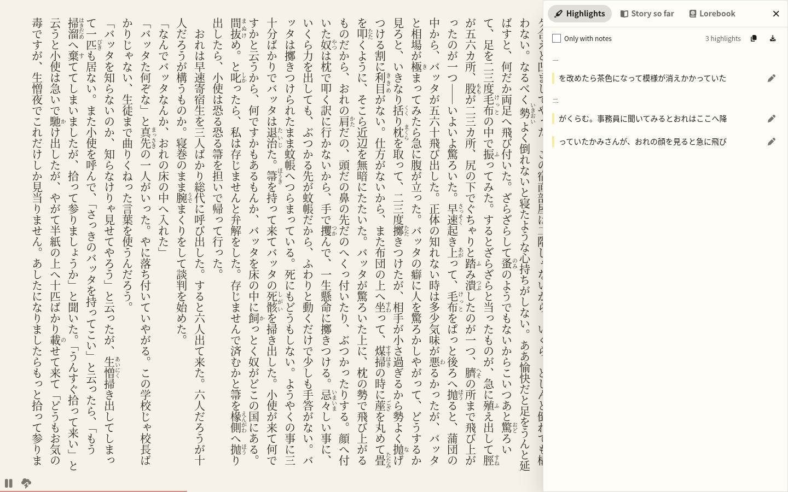 |

Desktop keys (physical positions, the same on any layout): <kbd>PageDown</kbd>/<kbd>PageUp</kbd>
pages, <kbd>n</kbd>/<kbd>m</kbd> chapters, <kbd>b</kbd>/<kbd>r</kbd> bookmark and return,
<kbd>Space</kbd> auto-scroll (<kbd>a</kbd>/<kbd>d</kbd> faster/slower), <kbd>p</kbd> the reading
tracker. Upstream's [README](https://github.com/ttu-ttu/ebook-reader#readme) covers every
control, the tracker and import/export.

### AI helpers (plugin)

Off until you turn on Settings → General → Plugins → AI tools, and they use your
own keys ([OpenRouter](https://openrouter.ai/) for text,
[ElevenLabs](https://elevenlabs.io/) for the voice), called straight from the
browser:

- **Ask AI** about a selection: explain, translate, nuance, or your own presets,
  with follow-up questions, in English or Japanese.
- **Story so far**: a spoiler-free recap of everything before your position, for
  coming back to a book after a break.
- **Lorebook**: characters, places and terms collected as you read, exportable
  as SillyTavern World Info and handed on to the next book of a series.
- **AI voice**: reads aloud from your position, highlighting each phrase.

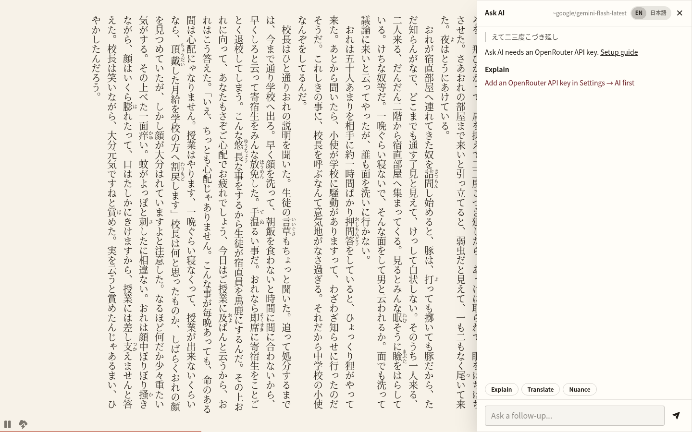

### Manga and visual novels

- **Manga** (CBZ, or ZIPs of images) open in a page-turning reader: right to
  left, left to right or a vertical strip.
- **Visual novels** for ONScripter run in the browser on
  [CONscripter](https://github.com/blankiekun/CONscripter), with the text laid
  over the game for Yomitan (backlogs and choices too), an optional text panel
  below it, and the text counted in progress, statistics and kanji met. Games
  are ZIPs or unpacked folders on the server (`VN_PATH`); saves sync across
  devices and big games can be kept offline. Games for other engines can often
  be converted with
  [conscripter-convert](https://github.com/blankiekun/conscripter-convert).


### For learners

- **Difficulty estimates** with [Jiten](https://github.com/Sirush/Jiten)'s
  features and a model trained on jiten.moe's scores, computed on your server:
  a score with its likely range, the vocabulary needed for 95% coverage, and how
  many of the book's kanji you have already met.
- **Statistics**: characters, time and speed per day and per book, streaks and
  reading goals (upstream's, synced per account).

### Accounts, themes and the admin panel

- **Accounts** with per-account permissions (`import`, `series`, `difficulty`);
  there is no sign-up, admins add readers.
- **Themes** colour the whole app, follow the system's light and dark mode, and
  can be written or imported ([themes.md](themes.md)).
- **Admin panel**: accounts and permissions, updates to the latest release or
  `main` (on servers set up with `scripts/deploy.sh`), the visual novel engine, catalog and series tools, and difficulty
  jobs.

| Themes                                                     | Admin panel                                                       | Phone                                                                                 |
| ---------------------------------------------------------- | ----------------------------------------------------------------- | ------------------------------------------------------------------------------------- |
| 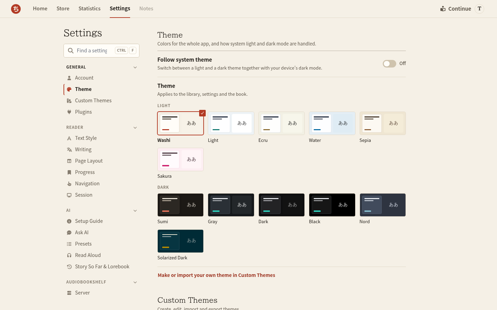 | 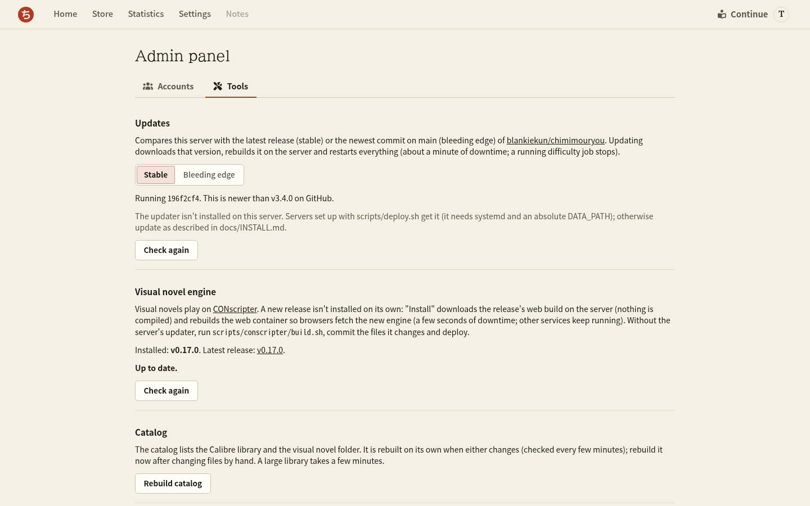 | 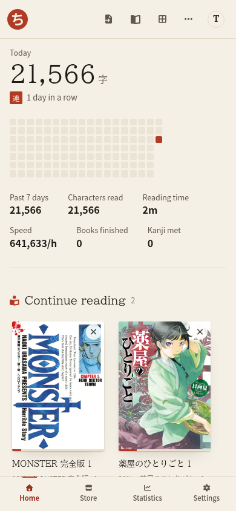 |

### Good to know

- EPUBs that render wrongly (e.g. unclosed links swallowing the text) may import
  correctly with Settings → Data → "Epub Import Fixes" set to standard or extended.
- Progress counts Japanese characters only, without Latin letters or punctuation.
- Books from the Calibre library come back from the server, but other browser
  data (settings without an account, books imported only into the browser)
  lives in the browser's storage, which the browser may clear when the disk fills
  up. Settings → Data shows whether storage is persistent.
