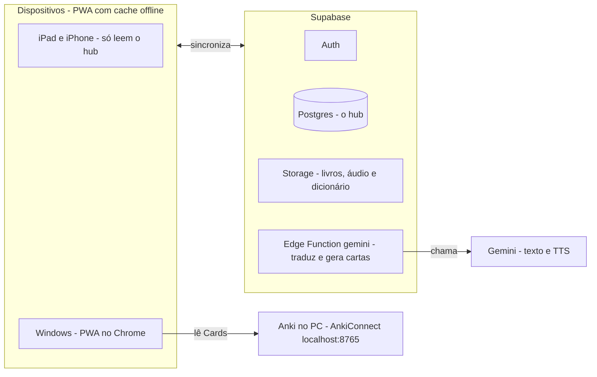

# Leitor de EPUB japonês com hub de vocabulário: escopo e plano de construção

Atualizado em 2026-10-20, depois da entrevista de escopo (registro em `docs/ENTREVISTA.md`, decisões com motivo em `docs/adr/`, termos em `GLOSSARY.md`). Este arquivo é a especificação do projeto. **Backend: Supabase.**

## Visão

O app é um leitor de EPUB em japonês, instalável como PWA, que reúne leitura, dicionário, criação de cards do Anki e um registro central do vocabulário que você conhece. Ele roda no iPad, no iPhone e no Windows, sincronizado pela sua conta no Supabase.

Princípios:

- Uso pessoal, com uma conta só.
- O Anki manda no estado das palavras que estão nele; a marca "Já sei" do app cobre as que não estão (ADR 0007). O app nunca escreve no Anki: as cartas chegam lá por .apkg.
- Funciona offline e sincroniza quando há rede.
- Sem Claude dentro do app. O Claude (via Claude Code) só ajuda a construir; a tradução da frase, o significado da palavra na carta e o áudio vêm do Gemini, chamado pelo servidor.
- Só EPUB de texto, sem DRM. Mangá e outros formatos ficam fora.
- O repositório é público: nada de chave, dado pessoal ou link privado nos arquivos.

## Interface

A interface segue os leitores graduados Yomu Yomu e DuChinese: tela de leitura limpa, e a palavra, o estado e a carta aparecem num painel ao toque, sem sair do texto. São quatro telas para o celular; no iPad e no Windows o painel da palavra pode ficar ao lado do texto.

| Tela           | O que mostra                                                                                                                                                                                                                                                                                                                                       |
| -------------- | -------------------------------------------------------------------------------------------------------------------------------------------------------------------------------------------------------------------------------------------------------------------------------------------------------------------------------------------------- |
| Início         | Calendário da semana, meta, progresso de leitura (tempo, caracteres e palavras conhecidas) e a navegação inferior                                                                                                                                                                                                                                  |
| Biblioteca     | Capas dos livros, progresso, cobertura de vocabulário (v2), ícone de nuvem nos livros ainda não baixados no aparelho e o botão "Importar EPUB"                                                                                                                                                                                                     |
| Leitor         | Texto limpo, com barra verde nos parágrafos já lidos; barra do topo (voltar, título, Aa, furigana, menu com "Desmarcar a partir daqui"); ao tocar numa palavra, painel inferior com a palavra, a leitura, a glosa em inglês, o estado, "Já sei" (v2), a marca "na fila" ou "exportada em <data>", o botão "Traduzir frase" e o botão "Criar carta" |
| Fila de cartas | Lista das cartas com o estado (pendente, gerando, gerada, erro, exportada), a opção de abrir e editar, os Lotes já exportados (data e aparelho) e o botão "Exportar .apkg"                                                                                                                                                                         |

Navegação inferior: Início, Biblioteca, Fila de cartas e Vocabulário (a tela de Vocabulário chega com o hub, na v2).

Esboço de três das telas:

```
+---------------------+  +---------------------+  +---------------------+
| Biblioteca          |  | Aa  furigana        |  | Fila de cartas      |
| +-----------------+ |  |┃======== ========== |  | +-----------------+ |
| | [capa] Livro 1  | |  |┃===========         |  | | 食べる  [gerada]| |
| |  progresso      | |  | 彼は朝ごはんを食べる。|  | | frase, trad.,   | |
| |  cobertura (v2) | |  | ==========  ======= |  | | áudio           | |
| +-----------------+ |  | ========= ========= |  | +-----------------+ |
| | [capa] Livro 2 ☁| |  |                     |  | | 眠る    [gerada]| |
| +-----------------+ |  | +-----------------+ |  | +-----------------+ |
| | [capa] Livro 3  | |  | |‹ 食べる  たべる ›| |  | | 急に  [pendente]| |
| +-----------------+ |  | | to eat          | |  | +-----------------+ |
|                     |  | | (aprendendo)    | |  | Lotes: 20/10 iPhone |
| [ Importar EPUB ]   |  | | [Criar carta]   | |  | [ Exportar .apkg ]  |
+---------------------+  +---------------------+  +---------------------+
```

No painel da palavra, o botão "Traduzir frase" fica ao lado do estado. Sem rede, ele aparece desativado com "sem conexão".

As telas foram aprovadas no protótipo D1 (20/10/2026), sem mudanças de conteúdo. O protótipo está no branch `prototype/d1-telas` (fora do `main`) e serve de referência visual para os itens V1.3 a V1.5. Detalhes que ele fixou:

- A Fila de cartas tem duas abas: "Na fila" (com "Exportar .apkg" fixo embaixo, mostrando o número de cartas e o tamanho estimado) e "Lotes" (cada Lote abre a lista das cartas e tem "Baixar este Lote de novo").
- Quando há carta com erro, a exportação mostra a opção "Incluir a carta com erro (sem o áudio que faltou)".
- Carta exportada abre só para leitura, com "Reexportar (sobrescreve o Card no Anki)". Criar carta de uma palavra já exportada pede confirmação no próprio painel.
- Na edição da carta, cada campo mostra de onde vem (dicionário, livro, JmdictFurigana, JPDB, Gemini, você ou vazio).
- Na Biblioteca, o livro na nuvem mostra o tamanho e o progresso do download ao ser tocado; o menu ⋯ do livro tem "Apagar livro".
- O que é da v2 ("Já sei", a aba de palavras na Início, a tela Vocabulário) aparece desativado com a marca v2 até lá.

### Toque e painel

- Regra dos toques (confirmada no protótipo D1, em 20/10; foi escolhida a variante B):
  - Tocar numa palavra abre o painel. Com o painel aberto, tocar em outra palavra troca o conteúdo.
  - A barra do topo aparece ao rolar o texto para cima e some ao rolar para baixo.
  - Tocar fora do texto (margem, espaço entre parágrafos, fim de linha) ou na pontuação (。、「」) só fecha o painel; com o painel fechado, não faz nada. Arrastar o painel para baixo também fecha.
  - Pendente para o V1.3: no modo de páginas (PC) e no começo de um capítulo não há rolagem para cima. Sugestão: nesses casos, a barra aparece ao tocar na faixa do topo ou ao levar o mouse até ela.
- A seleção é híbrida: o tokenizador decide onde a palavra começa e a busca no dicionário decide onde termina; setas ‹ › ajustam a seleção (ADR 0003). O painel mostra a parte selecionada e, quando difere, a forma de dicionário (ex.: "seleção: 立ち止まった → 立ち止まる").
- Partículas e auxiliares abrem o painel normalmente, com a marca "gramática · fora da cobertura" no lugar do estado.
- Quando a escrita tem várias leituras, o painel lista as entradas do dicionário pela frequência do JPDB; a que bate com o furigana do EPUB vem primeiro. "Criar carta" usa a entrada aberta.
- Palavra fora do dicionário (nomes em katakana, por exemplo): o painel mostra "não está no dicionário" e mantém "Traduzir frase" e "Criar carta".
- O toque não pode depender do modo de leitura (horizontal ou vertical, rolagem ou páginas). iPhone e iPad: horizontal com rolagem; PC: provavelmente vertical com páginas.

### Parágrafos lidos

Um parágrafo fica marcado como lido (barra verde) quando o Alcance, o ponto mais distante já lido no livro, passa do fim dele. O Alcance nunca volta quando você relê; o Marcador (onde você está agora) volta. Uma opção "desmarcar a partir daqui" cobre o caso de ter pulado páginas sem ler. Não há marcação manual.

### Furigana

Na v1, o botão de furigana mostra ou esconde só o furigana que já vem no EPUB (o que o ttu faz). A leitura de qualquer palavra aparece no painel. Furigana gerado para todo o texto e furigana adaptativo ficam juntos na v3.

O que copiar dos apps de referência:

| O que copiar                                         | De onde vem                    | Como entra no app                                                                      |
| ---------------------------------------------------- | ------------------------------ | -------------------------------------------------------------------------------------- |
| Leitura limpa, com informação escondida até o toque  | Yomu Yomu                      | Texto sem controles; a barra do topo aparece ao rolar para cima                        |
| Painel da palavra sem sair do texto                  | Yomu Yomu e DuChinese          | Painel inferior com leitura, glosa em inglês, estado, "Traduzir frase" e "Criar carta" |
| Tamanho da fonte e furigana do livro ajustáveis      | DuChinese                      | Botões Aa e furigana no topo; o ttu já tem essas opções para o furigana do EPUB        |
| Furigana só onde precisa                             | Yomu – Japanese Reader         | v3: gerar furigana e esconder o das palavras conhecidas                                |
| Salvar a palavra com um toque e exportar para o Anki | DuChinese                      | "Criar carta" leva à fila; a fila exporta .apkg                                        |
| Marcar até onde leu                                  | Leitor com parágrafos marcados | Barra verde automática pelo Alcance                                                    |

O que não entra: narração, lições, lembretes e notificações. A tradução da frase aparece só quando você pede, é feita pelo Gemini, precisa de internet, e as frases já traduzidas ficam em cache.

Um leitor parecido relatou dificuldade de acertar a palavra com o dedo no iPhone e partículas entrando na seleção. Por isso a seleção híbrida, as setas de ajuste e a área de toque generosa.

### Outros comportamentos

- **Apagar um livro** some com ele em todos os aparelhos e apaga de verdade os arquivos do bucket; estatísticas e cartas do livro ficam. A confirmação explica isso.
- **Nova versão do app:** aviso "Nova versão: atualizar" só fora do leitor; a versão nova também entra na próxima abertura do zero. A leitura nunca é interrompida (ADR 0011).
- **Continuar em outro aparelho:** ao abrir um livro, se outro aparelho tem marcador mais recente, o app pergunta "Você parou no iPad, cap. 3 (42%). Ir para lá?". Não pula sozinho.
- **Configurações:** versão e data do dicionário, "Baixar backup", "Restaurar backup" e "último backup: há N dias". Sem sincronização por Google Drive, OneDrive ou pasta local, e sem audiobook e legendas (o código do ttu fica, a interface some).

## Tela inicial

A tela inicial mostra quanto você leu e quanto do vocabulário já é seu. Não há lembretes nem notificações.

```
+--------------------------+   Calendário da semana: dia preenchido se você leu
| Calendário de leitura    |   Meta: tempo ou caracteres (metas do ttu)
| +----------------------+ |   Totais: tempo e caracteres (ttu);
| |     esta semana      | |           palavras conhecidas (hub, v2)
| | (o)(o)(o)(O)( )( )( )| |   Gráfico por dia: da aba escolhida
| |  S  T  Q  Q  S  S  D | |   Filtro: 7 dias, 30 dias ou tudo
| +----------------------+ |
| ( Definir meta )         |
| Progresso de leitura     |
| [tempo][caract.][palavras|
|                conhecidas]|
| +----------------------+ |
| | Tempo lido por dia   | |
| |  ▂ ▄ ▁ ▆ ▃ ▂ ▅ ▃ ▄ ▂ | |
| +----------------------+ |
|     (7 dias|30 dias|tudo)|
| Início Biblioteca Fila Vocab.|
+--------------------------+
```

| Bloco                | Como fica                                                                                                                                                                | Origem                                                 |
| -------------------- | ------------------------------------------------------------------------------------------------------------------------------------------------------------------------ | ------------------------------------------------------ |
| Calendário da semana | Segunda a domingo, com o dia de hoje destacado e setas para trocar de semana; o dia fica preenchido se você leu, e tocar nele mostra o tempo e os caracteres daquele dia | Estatísticas do ttu                                    |
| Meta                 | Meta de tempo ou de caracteres, por dia ou por semana                                                                                                                    | Metas do ttu                                           |
| Progresso            | Três abas com o total no topo: tempo, caracteres e palavras conhecidas; abaixo, o gráfico por dia e o filtro de 7 dias, 30 dias ou tudo                                  | Tempo e caracteres: ttu; palavras conhecidas: hub (v2) |
| Lista por livro      | Valor de cada livro no período da aba escolhida                                                                                                                          | Estatísticas por livro do ttu                          |
| Navegação inferior   | Início, Biblioteca, Fila de cartas e Vocabulário                                                                                                                         | Nova                                                   |

As estatísticas são gravadas uma linha por livro, dia e aparelho, e a tela soma as linhas na exibição: ler o mesmo livro no mesmo dia em dois aparelhos nunca perde tempo. A aba de palavras mostra as palavras que você sabe (o estado conhecida do hub), e não as palavras lidas. Ela só existe depois da v2; na v1 a tela mostra apenas tempo e caracteres. Para o gráfico, cada Sincronização do Anki grava um retrato do dia em `vocab_history`.

## Decisões fechadas

O projeto é um fork do leitor ttu com backend próprio e dicionário embutido, construído com Claude Code.

| Tema          | Decisão                                                                                                                          | Motivo                                                                                                |
| ------------- | -------------------------------------------------------------------------------------------------------------------------------- | ----------------------------------------------------------------------------------------------------- |
| Base          | Fork do ttu ebook-reader (SvelteKit, BSD-3)                                                                                      | O leitor já existe: modo vertical, contagem de caracteres, estatísticas de leitura                    |
| Backend       | Supabase (Auth, Postgres com RLS, Storage, Edge Functions)                                                                       | O ttu não tem backend. O plano gratuito cobre o app: 500 MB de banco, 1 GB de storage, Edge Functions |
| Livro         | Identificado pelo hash do EPUB; o bucket guarda o livro processado (para ler) e o EPUB original (backup)                         | ADR 0001                                                                                              |
| Sincronização | Última escrita vence pelo relógio do aparelho; o `updated_at` do servidor é só cursor                                            | ADR 0002                                                                                              |
| Dicionário    | JMdict (glosas em inglês) + JPDB (frequência) + JmdictFurigana, preparados no PC por script e baixados prontos por cada aparelho | ADR 0004; extensões do Safari não rodam em PWA instalada no iOS                                       |
| Deflexão      | Pela forma de dicionário que o tokenizador devolve, com regras próprias de reserva                                               | ADR 0005; o código do Yomitan é GPL                                                                   |
| Seleção       | Híbrida: tokenizador para o começo, dicionário para o fim, setas para ajustar                                                    | ADR 0003                                                                                              |
| Cards         | Palavras vão para uma fila; o app gera a parte local na hora e o servidor gera a parte do Gemini; exportação em .apkg            | ADR 0010; o guid fixo evita duplicatas ao reimportar                                                  |
| guid          | `guid_for("leituras-igor", palavra, leitura)`                                                                                    | ADR 0006; o Kaishi tem homógrafos (開く あく/ひらく)                                                  |
| Hub           | Progresso lido do Anki pelo AnkiConnect, no PC; casamento pela entrada do JMdict                                                 | ADR 0008, 0013; o AnkiWeb não tem API                                                                 |
| IA            | Gemini no servidor: tradução da frase, significado da palavra em português na carta e áudio; nada de Claude no app               | ADR 0009; o JMdict não tem português; a chave fica como secret de uma Edge Function                   |
| Formatos      | Apenas EPUB de texto, sem DRM                                                                                                    | Mangá exigiria OCR                                                                                    |
| Dispositivos  | iPad, iPhone e Windows                                                                                                           | Os três que você usa                                                                                  |

## Hub de vocabulário

Cada palavra do texto recebe um de três estados, calculado a partir dos Cards do Anki e da marca "Já sei".

| Estado       | Regra                                                                                                                           |
| ------------ | ------------------------------------------------------------------------------------------------------------------------------- |
| Conhecida    | Há um Card suspenso sem a etiqueta `leech`, ou o intervalo é de 21 dias ou mais, ou a palavra tem a marca "Já sei"              |
| Aprendendo   | Há Card ativo com intervalo menor que 21 dias (inclusive novos ainda não revisados), ou um Card suspenso com a etiqueta `leech` |
| Desconhecida | A palavra não está no Anki nem tem "Já sei"                                                                                     |

Se a palavra tem mais de um Card, vale o estado mais avançado. Uma Palavra é o par (Word, Word Reading), que existe igual no Kaishi e no tipo de nota "Leituras (estilo Kaishi)". O texto e o Anki são comparados pela entrada do JMdict, não pela escrita, então わかる no texto é o 分かる do Anki (ADR 0008). Basta a mesma entrada, com qualquer leitura: 皆 lido みな no texto pega o estado do Card みんな, e o painel mostra "no Anki como みんな" (ADR 0013). "Já sei" vale para a entrada. Um Card que não casa com nenhuma entrada fica guardado pela escrita.

Os decks lidos são o 日本語 e seus subdecks (hoje `1. Dokusho`, `2. Kaishi 1.5k` e `3. Old`), numa lista configurável.

**Já sei e cobertura (ADR 0007):** o painel tem o botão "Já sei" para palavras que você conhece e não estão no Anki. Uma importação inicial pode marcar como conhecidas as palavras do JPDB acima de uma frequência escolhida. Partículas, auxiliares e afins não contam na cobertura nem são destacados.

**Sincronização do Anki:** no Windows, o botão "Sincronizar Anki" pede primeiro ao AnkiConnect (localhost:8765) que o Anki do PC sincronize com o AnkiWeb (pega as revisões feitas no celular), espera terminar, lê todos os Cards dos decks configurados e grava o resultado no Supabase. Palavra que sumiu do Anki é marcada como apagada no hub e volta a desconhecida, salvo "Já sei". iPad e iPhone só leem. O estado só muda quando você sincroniza no PC (quase todo dia, então a defasagem é pequena), e o app mostra a data da última sincronização.

Uma palavra na fila não muda de estado; o painel mostra "na fila" ou "exportada em <data>", para você não mandá-la duas vezes.

O que o hub entrega:

- Destaque das palavras no texto por estado.
- Aviso na fila quando a palavra já está no Anki.
- Cobertura por livro: percentual de palavras conhecidas, sem gramática.
- Lista de palavras desconhecidas de um livro, ordenada por frequência.
- Aba de palavras conhecidas na tela inicial, com histórico.
- Lote "confirmado no Anki" quando a sincronização encontra os Cards dele.

## Cards: da seleção ao .apkg

Você toca numa palavra e escolhe "Criar carta". Ela entra na fila e o app gera os campos. O formato segue `docs/CARDS.md`: os 14 campos do Kaishi, o tipo de nota com `MODEL_ID` fixo e um guid calculado por palavra e leitura, então reimportar atualiza o Card em vez de duplicar.

Termos: **Carta** é o item da fila no app; **Card** é o que existe no Anki.

1. **Pendente:** ao tocar em "Criar carta", o aparelho preenche na hora, mesmo offline, tudo o que vem do dicionário. A carta espera a parte do Gemini. Você pode tirá-la da fila.
2. **Gerando:** a ação `generate` da Edge Function trava a carta, chama o Gemini, grava os áudios no bucket e preenche os campos. Uma segunda chamada para a mesma carta não faz nada (ADR 0010).
3. **Gerada:** todas as partes deram certo; você pode abrir a carta e editar.
4. **Erro:** alguma parte falhou depois de três tentativas automáticas com espera crescente; a carta mostra o motivo e o botão "Tentar de novo".
5. **Exportada:** entrou num Lote.

| Campo                                     | De onde vem                                                                            | Usa IA     |
| ----------------------------------------- | -------------------------------------------------------------------------------------- | ---------- |
| Word                                      | Forma de dicionário do verbete                                                         | Não        |
| Word Reading                              | Leitura do verbete, em hiragana                                                        | Não        |
| Word Meaning                              | Significado curto em português, no sentido da frase                                    | Gemini     |
| Word Furigana                             | Leitura kanji por kanji, do JmdictFurigana; fora dele, sobre a palavra inteira         | Não        |
| Sentence                                  | Frase do EPUB, com a palavra em `<b>` na forma em que aparece                          | Não        |
| Sentence Furigana                         | Leituras do JmdictFurigana ou do tokenizador, com espaço antes de kanji depois de kana | Não        |
| Sentence Meaning                          | Tradução da frase para português; reaproveita a que já foi pedida na leitura           | Gemini     |
| Word Audio, Sentence Audio                | Voz sintética em WAV                                                                   | Gemini TTS |
| Frequency                                 | Ranking do JPDB, só o número (vazio se não houver)                                     | Não        |
| Notes                                     | Opcional, digitada por você                                                            | Não        |
| Pitch Accent, Pitch Accent Notes, Picture | Vazios                                                                                 | Não        |

**A frase** vai do último 。！？ (ou começo do parágrafo) até o próximo, sem cortar dentro de 「」, sem o furigana do EPUB. Acima de ~150 caracteres, é cortada perto da palavra. Tem que sair boa de cara; é editável.

**Significado e tradução:** um só pedido ao Gemini devolve a tradução da frase e o significado da palavra, em português do Brasil natural mas próximo da estrutura. O pedido leva a frase anterior e a seguinte só como contexto. A glosa em inglês do dicionário fica no painel e não vai para a carta (ADR 0009).

**Áudio:** o Gemini devolve PCM (24 kHz, 16 bits, mono); a Edge Function acrescenta o cabeçalho WAV e corta o silêncio das pontas. A voz da palavra sai em cadeia: a palavra escrita com a leitura como dica (dá o acento), conferida por um modelo que ouve o áudio; se a leitura não bate, a voz lê a kana; se nem assim bate, a carta fica marcada "confira a voz" na fila (CARDS.md; R5). A carta tem o campo opcional "Texto para a voz" (em kana) e o botão "Refazer áudio". O áudio fica no bucket até 30 dias depois de o Lote ser baixado; reexportar depois disso gera o áudio de novo.

**Etiquetas:** `dokusho` e `dokusho::<título do livro>` (espaços trocados por `_`).

Regras da fila:

- Palavra que já está no Anki (conhecida ou aprendendo) só entra na fila se você confirmar (v2).
- Os campos gerados ficam visíveis e editáveis.
- A chave do Gemini fica como secret da Edge Function; o app nunca a vê.
- "Exportar .apkg" inclui só as cartas geradas e ainda não exportadas, e mostra o tamanho estimado do Lote (aviso acima de 100 cartas). Uma carta em erro pode entrar, sem áudio, se você escolher.
- Cada carta é exportada uma vez. Corrigir depois de exportada é no Anki. Reexportar é ação explícita, com o aviso de que sobrescreve o Card.
- Cada Lote mostra data e aparelho onde foi baixado; baixar o mesmo Lote em outro aparelho gera aviso. Importe cada Lote num lugar só.
- No iPhone e no iPad, a exportação abre a folha de compartilhamento do iOS (envio direto ao AnkiMobile); no Windows, é um download.
- Mudar o formato continua sendo editar `docs/CARDS.md`, uma vez só.

## Roadmap por versão

A v1 entrega o leitor sincronizado com criação de cartas; a v2 liga o hub ao Anki; a v3 é opcional.

| Versão        | O que entra                                                                                                                                                                                                                                                                                                                                  | Pronto quando                                                                                                                                                                |
| ------------- | -------------------------------------------------------------------------------------------------------------------------------------------------------------------------------------------------------------------------------------------------------------------------------------------------------------------------------------------- | ---------------------------------------------------------------------------------------------------------------------------------------------------------------------------- |
| v1            | Fork do ttu com biblioteca, marcador e estatísticas no Supabase; dicionário embutido; tela inicial com calendário, meta, tempo e caracteres lidos; parágrafos lidos; consulta ao tocar na palavra; "Traduzir frase" (Gemini); fila de cartas com geração (tradução, significado em português e áudio pelo Gemini) e exportação .apkg; backup | Você lê no iPad, continua no iPhone no mesmo ponto, e 10 palavras na fila viram cartas com significado em português e áudio, que importam no Anki sem duplicar ao reimportar |
| v2            | Botão Sincronizar Anki; estados conhecida, aprendendo e desconhecida; "Já sei" e importação inicial por frequência; destaque no texto; aviso de palavra já no Anki; cobertura por livro; lista de desconhecidas por frequência; aba de palavras conhecidas na tela inicial; Lote confirmado no Anki                                          | Abrir um EPUB mostra a cobertura em %, e uma palavra conhecida no Anki aparece destacada no iPad depois de sincronizar no PC                                                 |
| v3 (opcional) | Furigana gerado e adaptativo; estatísticas cruzando leitura e vocabulário, com palavras vistas; exportação em CSV das palavras conhecidas e em aprendizado                                                                                                                                                                                   | Cada item funciona sozinho; nenhum bloqueia os outros                                                                                                                        |

Fora do escopo: mangá e formatos que não sejam EPUB de texto; EPUB com DRM; Claude ou qualquer LLM além do Gemini; extensão do Yomitan; notificações e lembretes; mais de um usuário; cards gerados pelas conversas do Claude; folhas de escrita e KANJIDIC; dicionário de nomes (JMnedict); pitch accent; sincronização por Google Drive, OneDrive ou pasta local; audiobook e legendas do ttu; envio direto ao Anki pelo AnkiConnect; outro idioma; texto que não venha de EPUB; explicação de gramática.

## Arquitetura e modelo de dados

O app grava e lê tudo no Supabase; só o Windows conversa com o Anki e só a Edge Function conversa com o Gemini.



O iPad e o iPhone recebem o estado do vocabulário já sincronizado. O .apkg é gerado no próprio dispositivo e importado no Anki. A Edge Function `gemini` tem duas ações: `translate` (tradução da frase pedida na leitura) e `generate` (a parte Gemini de uma carta: tradução, significado e os dois áudios). O dicionário vive só no dispositivo (IndexedDB).

| Tabela (Supabase/Postgres) | Conteúdo                                                                                                                                                             |
| -------------------------- | -------------------------------------------------------------------------------------------------------------------------------------------------------------------- |
| books                      | Id = hash do EPUB, título, capa, total de caracteres, caminhos do livro processado e do EPUB original no bucket `epubs`                                              |
| bookmarks                  | Marcador e Alcance, um por livro, com o horário do aparelho                                                                                                          |
| reading_stats              | Tempo, caracteres e velocidade por livro, dia e aparelho                                                                                                             |
| reading_goals              | Metas de tempo e de caracteres                                                                                                                                       |
| vocab                      | Palavra, leitura, entrada do JMdict, origem (anki ou já sei), estado, intervalo, suspensa, leech e data da sincronização; chave primária (user_id, word, reading)    |
| vocab_history              | Um retrato por Sincronização do Anki: data, total de conhecidas e de aprendendo                                                                                      |
| translations               | Cache das traduções pedidas na leitura: frase em japonês, tradução e data; chave primária (user_id, sha256 da frase)                                                 |
| batch_items                | As cartas: campos, frase, livro, estado (pendente, gerando, gerada, erro, exportada), motivo do erro, texto para a voz, caminhos dos áudios no bucket `audio` e Lote |
| lotes                      | Data da exportação, aparelho onde foi baixado, cartas, confirmado no Anki                                                                                            |
| gemini_usage               | Contagem diária de chamadas ao Gemini, para o teto                                                                                                                   |

**Sincronização:** vale a última escrita pelo horário do aparelho em que você agiu; o `updated_at` do servidor serve só para cada aparelho perguntar o que mudou (ADR 0002). Exclusões são marcadas, não apagadas, o que evita o problema do merge do ttu que ressuscita dado apagado. Toda tabela tem `user_id uuid references auth.users`, `updated_at`, `deleted_at` (soft delete) e RLS `user_id = auth.uid()`. vocab usa upsert na chave (user_id, word, reading).

**Marcador:** sobe a cada ~15 s depois de virar a página e quando o app vai para segundo plano (no iOS, o envio na saída muitas vezes não chega).

**Aparelho novo ou dados apagados pelo iOS:** o app baixa sozinho a lista de livros, capas, marcadores, estatísticas, metas, fila e hub. Cada livro é baixado quando você o abre. O dicionário é baixado no primeiro toque, com aviso de tamanho. O app pede armazenamento persistente (`storage.persist()`).

**Buckets privados:** `epubs` e `audio` (política por pasta `<user_id>/...`) e `dicts` (o dicionário no formato do app, gerado pelo script `tools/` a partir dos zips Yomitan da pasta local `dicts/`). Os arquivos pesados (dicionário e tokenizador) ficam fora de `static/`, porque o service worker baixa tudo de `static/` de novo a cada deploy; o dicionário vai para o IndexedDB e o tokenizador para um cache versionado com nome próprio que o deploy não apaga. O schema vive em `supabase/migrations/`.

**Segurança:** login por e-mail e senha (sem magic link: no iOS o link abre no Safari, que não compartilha dados com a PWA). O cadastro fica desligado no Supabase depois de criada a sua conta. A Edge Function aceita só o usuário do secret `ALLOWED_USER_ID` e respeita um teto diário de chamadas (ex.: 300). A `GEMINI_API_KEY` é do projeto pago do Google, com alerta de orçamento (ex.: US$ 5 por mês). Os nomes dos modelos ficam em configuração da função, com lista de reserva. O `webCorsOriginList` do AnkiConnect libera só a URL de produção e `http://localhost:5173`, nunca `*`. A leitura funciona com sessão vencida; a sincronização espera a rede.

**Backup:** o plano gratuito do Supabase não dá backups para baixar. "Baixar backup" gera um zip com todas as tabelas em JSON (sem EPUBs e áudios), e "Restaurar backup" volta a partir dele.

**Deploy:** Vercel, só a branch `main`, previews desligados, num subdomínio fixo da Vercel (sem domínio próprio; mudar de endereço depois obriga a reinstalar a PWA em cada aparelho). Migrações só por `db push` revisado.

## Riscos e testes antes de construir

| Risco                                 | Como testar                                                                                                                                                                                                                       | Se falhar                                                                                      |
| ------------------------------------- | --------------------------------------------------------------------------------------------------------------------------------------------------------------------------------------------------------------------------------- | ---------------------------------------------------------------------------------------------- |
| Dicionário pesado no iPhone           | Baixar o dicionário preparado e o tokenizador na PWA instalada; metas: download ≤ 60 MB, preparação ≤ 1 min, consulta ≤ 100 ms                                                                                                    | Cortar entradas raras do dicionário                                                            |
| AnkiConnect a partir do navegador     | `fetch` do app em https para localhost:8765 no Chrome, com o `webCorsOriginList` exato; o Chrome pode pedir permissão de rede local. Nunca usar `getDeckStats` (cria deck quando o nome não existe)                               | Pequeno agente local no PC que envia os dados ao Supabase                                      |
| Casar texto com Anki                  | Tokenizar um EPUB e medir quantas palavras casam com o Anki pela entrada do JMdict; contar os Cards sem entrada; checar homófonos e palavras só em kana                                                                           | Ajustar as regras de casamento                                                                 |
| Furigana automático                   | Gerar 30 frases e comparar com o seu padrão                                                                                                                                                                                       | Facilitar a edição manual na tela da carta                                                     |
| Compatibilidade do .apkg              | Importar no Anki do PC e no AnkiMobile (pela folha de compartilhamento, na PWA instalada), reimportar o mesmo lote e conferir que não duplica nem mexe no tipo de nota do Kaishi; gerar um Lote de 100 cartas com áudio no iPhone | Corrigir o port do `guid_for` do genanki, comparando com a saída do Python; exportar em partes |
| Dados apagados no iOS                 | Usar a PWA instalada e tratar o Supabase como fonte da verdade                                                                                                                                                                    | Baixar de novo livros e dicionário                                                             |
| Tradução, significado e voz do Gemini | Gerar 30 cartas e comparar tradução, significado e áudio com o seu padrão; ouvir palavras de leitura ambígua com a instrução de pronúncia                                                                                         | Editar na carta; usar o "Texto para a voz" em kana                                             |
| Tamanho do áudio                      | Exportar um lote com áudio em WAV e ver o tamanho do .apkg (~300 KB por carta)                                                                                                                                                    | Converter para MP3 no navegador                                                                |
| Toque na palavra errada no celular    | Ler um capítulo no iPhone tocando em 30 palavras, em cada combinação de modo usada; contar seleções erradas                                                                                                                       | Ajustar a seleção e aumentar a área de toque                                                   |
| Projeto pausado por inatividade       | O plano gratuito pausa o projeto após uma semana sem uso                                                                                                                                                                          | O app segue offline e mostra "servidor pausado; reative no painel do Supabase" com o link      |
| Espaço no plano gratuito              | Somar livros (processado + original) e áudio contra 1 GB                                                                                                                                                                          | Apagar áudio mais cedo, tirar o EPUB original do bucket ou migrar para o plano pago            |
| Atualização do app no meio da leitura | Publicar uma versão com o app aberto e abrir o painel da palavra                                                                                                                                                                  | ADR 0011: sem `skipWaiting` automático                                                         |
| Abuso da função `gemini`              | Tentar chamar a função com outro usuário e acima do teto                                                                                                                                                                          | Cadastro desligado, `ALLOWED_USER_ID`, teto diário                                             |

Licença: o ttu é BSD-3, sem restrição para o fork. O código do Yomitan é GPL-3.0, então a busca e a deflexão são implementações próprias. JMdict e JmdictFurigana são CC BY-SA.

## Decisões recentes

As decisões de 15/10 continuam valendo, com duas mudanças em 20/10: o significado da palavra na carta passou a ser em português, pelo Gemini (antes: glosa em inglês); e a etiqueta ganhou o livro (`dokusho::<título>`). As demais decisões de 20/10 estão em `docs/ENTREVISTA.md` e em `docs/adr/`.

1. **Deck de destino:** `日本語::1. Dokusho`, prefixo de guid `leituras-igor`, conforme docs/CARDS.md. O Anki casa o deck pelo nome na importação.
2. **Cards novos:** um Card adicionado como novo e ainda não estudado conta como aprendendo.
3. **Áudio:** WAV, sem conversão. O teste de tamanho dos riscos diz se vale converter para MP3 depois.
4. **Significado:** o painel usa a glosa em inglês do dicionário; a carta usa significado e tradução da frase em português.
5. **Decks lidos pelo hub:** o 日本語 e seus subdecks.
6. **Backend:** Supabase, plano gratuito.
7. **Tela inicial:** sem lembretes nem notificações; a aba de palavras mostra as palavras conhecidas, não as lidas.
8. **Navegação:** Início, Biblioteca, Fila de cartas e Vocabulário.
9. **Tradução da frase na leitura:** botão "Traduzir frase" no painel, feito pelo Gemini e guardado em cache; a carta reaproveita a tradução já pedida.

## Como construir com Claude

Construa em fases pequenas, cada uma com um teste que prova que funciona. O roteiro está em `docs/FASES.md` e o estado em `docs/PROGRESSO.md`.

| Fase               | O que fazer                                                    | Como saber que terminou                                                           |
| ------------------ | -------------------------------------------------------------- | --------------------------------------------------------------------------------- |
| 0. Testes de risco | Um script ou página pequena para cada teste da lista de riscos | Cada teste tem o resultado anotado; se algum falha, entra o plano de contingência |
| 1. v1              | Itens V1.1 a V1.7 do FASES                                     | O critério "pronto quando" da v1                                                  |
| 2. v2              | Itens V2.1 a V2.4                                              | O critério "pronto quando" da v2                                                  |
| 3. v3              | Os itens opcionais, um de cada vez                             | Cada item funciona sozinho                                                        |

No Claude Code:

- Em cada fase, comece no plan mode e leia o plano antes de aprovar.
- Escreva os testes antes do código nas partes que têm resposta certa: guid e .apkg (compare com a saída do genanki em Python), estados do hub, casamento de palavras e deflexão.
- Faça um commit por passo pequeno e use `/clear` ao trocar de fase, com o `CLAUDE.md` atualizado.
- Nunca cole chaves no chat; o Gemini entra só como secret da Edge Function (`GEMINI_API_KEY`).

Modelos:

| Tarefa                                                      | Modelo                                      |
| ----------------------------------------------------------- | ------------------------------------------- |
| Planejar cada fase, no plan mode do Claude Code             | Opus                                        |
| Implementar com plano e testes prontos                      | Sonnet                                      |
| Bug que travou (sincronização, casamento de palavras, guid) | Opus por uma rodada, depois volta ao Sonnet |

## Fontes

- [Yomu Yomu na App Store](https://apps.apple.com/us/app/yomu-yomu-%EC%9D%BC%EB%B3%B8%EC%96%B4-%EC%9D%BD%EA%B8%B0/id1636640840?l=ko)
- [Yomu Yomu: apresentação no fórum Flexi Classes](https://forum.flexiclasses.com/t/yomu-yomu-a-new-graded-reader-for-japanese/2653)
- [Du Chinese: resenha do Ninchanese](https://ninchanese.com/?p=13876)
- [Du Chinese: site oficial](https://duchinese.net/)
- [Yomu – Japanese Reader (furigana adaptativo)](https://iphoneaddict.fr/apps/education/yomu-japanese-reader-310.html)
- [Relato sobre toque na palavra em um leitor parecido](https://community.wanikani.com/t/new-ios-app-for-japanese-reading-with-adjustable-furigana-%E2%80%93-looking-for-testers/72834)
- [ttu ebook-reader](https://github.com/ttu-ttu/ebook-reader)
- [Supabase: preços](https://supabase.com/pricing)
- [JmdictFurigana](https://github.com/Doublevil/JmdictFurigana)
