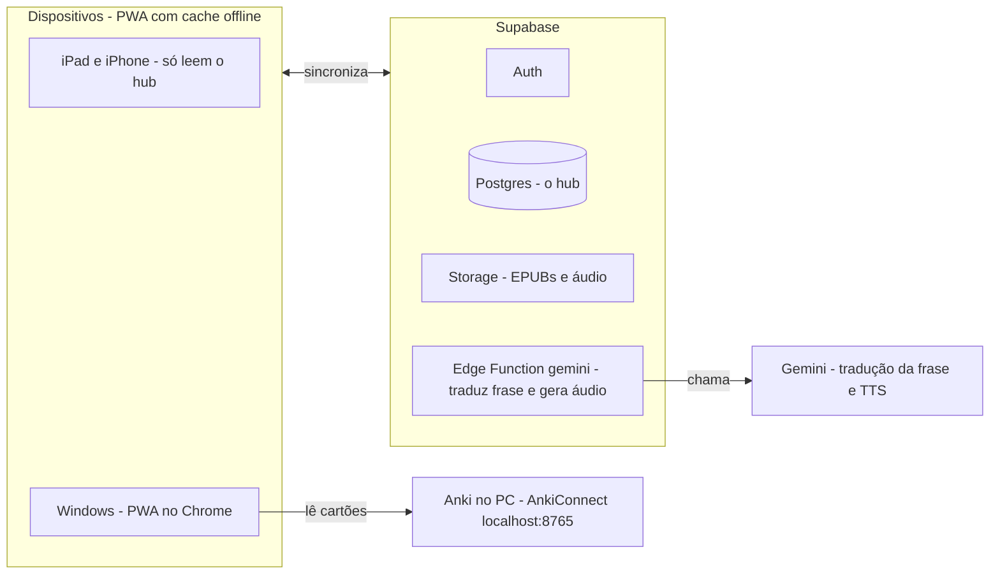

# Leitor de EPUB japonês com hub de vocabulário: escopo e plano de construção

Atualizado em 2026-10-15. Este arquivo é a especificação do projeto. **Backend: Supabase** (o projeto já foi criado); onde versões antigas diziam Appwrite, vale Supabase.

## Visão

O app é um leitor de EPUB em japonês, instalável como PWA, que reúne leitura, dicionário, criação de cards do Anki e um registro central do vocabulário que você conhece. Ele roda no iPad, no iPhone e no Windows, sincronizado pela sua conta no Supabase.

Princípios:

- Uso pessoal, com uma conta só.
- O Anki continua sendo a fonte da verdade do progresso; o app só lê.
- Funciona offline e sincroniza quando há rede.
- Sem Claude dentro do app. O Claude (via Claude Code) só ajuda a construir; a tradução das frases e o áudio dos cards vêm do Gemini, chamado pelo servidor.
- Só EPUB de texto. Mangá e outros formatos ficam fora.

## Interface

A interface segue os leitores graduados Yomu Yomu e DuChinese: tela de leitura limpa, e a palavra, o estado e o cartão aparecem num painel ao toque, sem sair do texto. São quatro telas para o celular; no iPad e no Windows o painel da palavra pode ficar ao lado do texto.

| Tela | O que mostra |
| --- | --- |
| Início | Calendário da semana, meta, progresso de leitura (tempo, caracteres e palavras conhecidas) e a navegação inferior |
| Biblioteca | Capas dos EPUBs, progresso, cobertura de vocabulário (v2) e o botão "Importar EPUB" |
| Leitor | Texto limpo; barra do topo (Aa, furigana) que aparece ao tocar; ao tocar numa palavra, painel inferior com a palavra, a leitura, a glosa em inglês, o estado (conhecida, aprendendo, desconhecida), o botão "Traduzir frase" e o botão "Virar cartão" |
| Fila de cartas | Lista das palavras com o estado da carta (pendente, gerada), a opção de abrir e editar, e o botão "Exportar .apkg" |

Navegação inferior: Início, Biblioteca, Fila de cartas e Vocabulário (a tela de Vocabulário chega com o hub, na v2).

Esboço de três das telas:

```
+---------------------+  +---------------------+  +---------------------+
| Biblioteca          |  | Aa  furigana        |  | Fila de cartas      |
| +-----------------+ |  | ======== ========== |  | +-----------------+ |
| | [capa] Livro 1  | |  | ===========         |  | | 食べる  [gerada]| |
| |  progresso      | |  | 彼は朝ごはんを食べる。|  | | frase, trad.,   | |
| |  cobertura (v2) | |  | ==========  ======= |  | | áudio           | |
| +-----------------+ |  | ========= ========= |  | +-----------------+ |
| | [capa] Livro 2  | |  |                     |  | | 眠る    [gerada]| |
| +-----------------+ |  | +-----------------+ |  | +-----------------+ |
| | [capa] Livro 3  | |  | | 食べる   たべる | |  | | 急に  [pendente]| |
| +-----------------+ |  | | to eat          | |  | +-----------------+ |
|                     |  | | (aprendendo)    | |  |                     |
| [ Importar EPUB ]   |  | | [Virar cartão]  | |  | [ Exportar .apkg ]  |
+---------------------+  +---------------------+  +---------------------+
```

No painel da palavra, o botão "Traduzir frase" fica ao lado do estado (aprendendo, conhecida ou desconhecida).

O que copiar dos apps de referência:

| O que copiar | De onde vem | Como entra no app |
| --- | --- | --- |
| Leitura limpa, com informação escondida até o toque | Yomu Yomu | Texto sem controles; a barra do topo aparece ao tocar |
| Painel da palavra sem sair do texto | Yomu Yomu e DuChinese | Painel inferior com leitura, glosa em inglês, estado, botão "Traduzir frase" e "Virar cartão" |
| Furigana e tamanho da fonte ajustáveis | DuChinese (pinyin ligado e desligado) | Botões Aa e furigana no topo; o ttu já tem essas opções |
| Furigana só onde precisa | Apps com furigana adaptativo, como o Yomu – Japanese Reader | v3: esconder o furigana das palavras que o hub marca como conhecidas |
| Salvar a palavra com um toque e exportar para o Anki | DuChinese | "Virar cartão" leva à fila; a fila exporta .apkg |

O que não entra: narração, lições, lembretes e notificações. A tradução da frase aparece só quando você pede, pelo botão "Traduzir frase" no painel da palavra, e é feita pelo Gemini; precisa de internet, e as frases já traduzidas ficam em cache.

Um leitor parecido relatou dificuldade de acertar a palavra com o dedo no iPhone e partículas entrando na seleção. Por isso o toque usa o tokenizador para selecionar a palavra inteira, sem a partícula, com área de toque generosa.

## Tela inicial

A tela inicial mostra quanto você leu e quanto do vocabulário já é seu, no estilo do calendário de leitura e do painel de progresso do print que você mandou. Não há lembretes nem notificações.

```
+--------------------------+   Calendário da semana: dia preenchido se você leu
| Calendário de leitura    |   Meta: tempo ou caracteres (metas do ttu)
| +----------------------+ |   Totais: tempo e caracteres (ttu);
| |     esta semana      | |           palavras conhecidas (hub, v2)
| | (o)(o)(o)(O)( )( )( )| |   Gráfico por dia: da aba escolhida
| |  S  T  Q  Q  S  S  D | |   Filtro: 7 dias, 30 dias ou tudo
| +----------------------+ |
| ( Definir meta )         |
| Progresso de leitura     |
| [tempo][caract.][palavras|
|                conhecidas]|
| +----------------------+ |
| | Tempo lido por dia   | |
| |  ▂ ▄ ▁ ▆ ▃ ▂ ▅ ▃ ▄ ▂ | |
| +----------------------+ |
|     (7 dias|30 dias|tudo)|
| Início Biblioteca Fila Vocab.|
+--------------------------+
```

| Bloco | Como fica | Origem |
| --- | --- | --- |
| Calendário da semana | Segunda a domingo, com o dia de hoje destacado e setas para trocar de semana; o dia fica preenchido se você leu, e tocar nele mostra o tempo e os caracteres daquele dia | Estatísticas do ttu |
| Meta | Meta de tempo ou de caracteres, por dia ou por semana | Metas do ttu |
| Progresso | Três abas com o total no topo: tempo, caracteres e palavras conhecidas; abaixo, o gráfico por dia e o filtro de 7 dias, 30 dias ou tudo | Tempo e caracteres: ttu; palavras conhecidas: hub (v2) |
| Lista por livro | Valor de cada livro no período da aba escolhida | Estatísticas por livro do ttu |
| Navegação inferior | Início, Biblioteca, Fila de cartas e Vocabulário | Nova |

A aba de palavras mostra as palavras que você sabe (o estado conhecida do hub), e não as palavras lidas: o total de hoje e quantas passaram a ser conhecidas no período. Ela só existe depois da v2; na v1 a tela mostra apenas tempo e caracteres. Para o gráfico, cada sincronização do Anki grava um retrato do dia na coleção `vocab_history`.

## Decisões fechadas

O projeto é um fork do leitor ttu com backend próprio e dicionário embutido, construído com Claude Code.

| Tema | Decisão | Motivo |
| --- | --- | --- |
| Base | Fork do ttu ebook-reader (SvelteKit, BSD-3) | O leitor já existe: modo vertical, contagem de caracteres, estatísticas de leitura |
| Backend | Supabase (Auth, Postgres com RLS, Storage, Edge Functions) | O ttu não tem backend; a sincronização dele é export/import por Drive. O plano gratuito do Supabase cobre o app: 500 MB de banco, 1 GB de storage, Edge Functions |
| Dicionário | Embutido, importando o formato Yomitan; glosas em inglês | Extensões do Safari, pelo que sei, não rodam em PWA instalada no iOS |
| Cards | Palavras vão para uma fila; as cartas são geradas automaticamente e exportadas em .apkg | O guid fixo evita duplicatas ao reimportar |
| Hub | Progresso lido do Anki pelo AnkiConnect, no PC | O AnkiWeb não tem API; o Windows já roda o Anki |
| IA | Gemini no servidor, só para traduzir a frase e gerar o áudio; nada de Claude no app | O significado das palavras fica em inglês e só a tradução da frase é em português; a chave fica como secret de uma Edge Function do Supabase |
| Formatos | Apenas EPUB de texto | Mangá exigiria OCR |
| Dispositivos | iPad, iPhone e Windows | Os três que você usa |

## Hub de vocabulário

Cada palavra do texto recebe um de três estados, calculado a partir dos cartões do Anki.

| Estado | Regra |
| --- | --- |
| Conhecida | Há um cartão suspenso, ou o intervalo é de 21 dias ou mais |
| Aprendendo | Há cartão ativo com intervalo menor que 21 dias, inclusive cartões novos ainda não revisados |
| Desconhecida | A palavra não está no Anki |

Se a palavra tem mais de um cartão, vale o estado mais avançado. A chave é o par (Word, Word Reading), que existe igual no Kaishi e no tipo de nota "Leituras (estilo Kaishi)". Os decks lidos são o 日本語 e seus subdecks, numa lista configurável.

Sincronização: no Windows, um botão "Sincronizar Anki" lê os cartões pelo AnkiConnect (localhost:8765) e grava o resultado no Supabase. iPad e iPhone só leem. Por isso o estado só muda quando você sincroniza no PC, e o app mostra a data da última sincronização.

O que o hub entrega:

- Destaque das palavras no texto por estado.
- Aviso na fila quando a palavra já está no Anki.
- Cobertura por livro: percentual de palavras conhecidas.
- Lista de palavras desconhecidas de um livro, ordenada por frequência.
- Aba de palavras conhecidas na tela inicial, com histórico.

## Cards: da seleção ao .apkg

Você seleciona uma palavra no texto e escolhe "virar cartão". Ela entra numa fila de cartas pendentes e o app gera os campos sozinho. O formato segue o documento "Cards de Anki: formato e gerador" (`docs/CARDS.md`): os 14 campos do Kaishi, o tipo de nota com `MODEL_ID` fixo e um guid calculado por deck e palavra, então reimportar atualiza o card em vez de duplicar.

1. **Selecionada:** você toca na palavra e escolhe "virar cartão".
2. **Pendente:** a palavra aparece no menu da fila, de onde você pode tirá-la.
3. **Gerada:** o app monta os campos, a tradução e o áudio sozinho; você pode abrir a carta e editar.
4. **Exportada:** o botão "Exportar .apkg" cria um arquivo com todas as cartas geradas, para importar no Anki.

| Campo | De onde vem | Usa IA |
| --- | --- | --- |
| Word | Forma de dicionário do verbete | Não |
| Word Reading | Leitura do verbete, em hiragana | Não |
| Word Meaning | Glosa em inglês do dicionário, sem tradução | Não |
| Word Furigana | Leitura alinhada kanji por kanji, calculada | Não |
| Sentence | Frase do EPUB, com a palavra em `<b>` na forma em que aparece | Não |
| Sentence Furigana | Leituras do tokenizador, com espaço antes de kanji depois de kana | Não |
| Sentence Meaning | Tradução da frase para português; reaproveita a que já foi pedida na leitura | Gemini |
| Word Audio, Sentence Audio | Voz sintética em WAV, como no documento de cards | Gemini TTS |
| Frequency | Dicionário de frequência importado | Não |
| Notes | Opcional, digitada por você | Não |
| Pitch Accent, Pitch Accent Notes, Picture | Vazios, como hoje | Não |

Regras da fila:

- Palavra que já está no Anki (conhecida ou aprendendo) só entra na fila se você confirmar.
- A geração precisa de internet; sem rede, a carta fica pendente e é gerada depois.
- Os campos gerados ficam visíveis e editáveis, para você conferir leituras e traduções, como pede o documento de cards.
- A chave do Gemini fica como secret da Edge Function do Supabase; o app nunca a vê.
- Mudar o formato continua sendo editar o documento de cards, uma vez só; o app segue o que está lá.

## Roadmap por versão

A v1 entrega o leitor sincronizado com criação de cards; a v2 liga o hub ao Anki; a v3 é opcional.

| Versão | O que entra | Pronto quando |
| --- | --- | --- |
| v1 | Fork do ttu com biblioteca, bookmark e estatísticas no Supabase; importação de dicionários Yomitan; tela inicial com calendário, meta, tempo e caracteres lidos; consulta ao tocar na palavra; botão Traduzir frase (Gemini); fila de cartas com geração automática (tradução da frase e áudio pelo Gemini) e exportação .apkg | Você lê no iPad, continua no iPhone no mesmo ponto, e 10 palavras na fila viram cartas com áudio e importam no Anki sem duplicar ao reimportar |
| v2 | Botão Sincronizar Anki; estados conhecida, aprendendo e desconhecida; destaque no texto; aviso de palavra já no Anki; cobertura por livro; lista de desconhecidas por frequência; aba de palavras conhecidas na tela inicial | Abrir um EPUB mostra a cobertura em %, e uma palavra conhecida no Anki aparece destacada no iPad depois de sincronizar no PC |
| v3 (opcional) | Kanji conhecidos para folhas de escrita; estatísticas cruzando leitura e vocabulário; exportação em CSV das palavras conhecidas e em aprendizado; furigana adaptativo | Cada item funciona sozinho; nenhum bloqueia os outros |

Fora do escopo: mangá e outros formatos, Claude dentro do app, extensão do Yomitan, notificações e lembretes, mais de um usuário.

## Arquitetura e modelo de dados

O app grava e lê tudo no Supabase; só o Windows conversa com o Anki e só a Edge Function conversa com o Gemini.



O iPad e o iPhone recebem o estado do vocabulário já sincronizado. O .apkg é gerado no próprio dispositivo e importado no Anki. A Edge Function `gemini` chama o Gemini para traduzir a frase e gerar o áudio, e a chave fica lá como secret. Uma só função atende as duas ações (`action: translate | tts`). Os dicionários ficam só no dispositivo (IndexedDB).

| Tabela (Supabase/Postgres) | Conteúdo |
| --- | --- |
| books | Título, capa, total de caracteres e o caminho do EPUB no bucket `epubs` |
| bookmarks | Posição e progresso, um documento por livro |
| reading_stats | Tempo, caracteres e velocidade por livro e por dia |
| reading_goals | Metas de tempo e de caracteres |
| vocab | Palavra, leitura, estado, intervalo, suspensa e data da sincronização; chave primária (user_id, word, reading) |
| vocab_history | Um retrato por sincronização do Anki: data, total de conhecidas e de aprendendo |
| translations | Cache das traduções pedidas na leitura: frase em japonês, tradução e data; chave primária (user_id, sha256 da frase) |
| batch_items | Campos do card, frase, estado (pendente, gerada, exportada), caminho do áudio no bucket `audio` e data de exportação |

O sync usa a data de atualização (vale a última escrita) e marca exclusões em vez de apagar. O README do ttu avisa que dado apagado pode voltar no merge dele, e isso evita o problema. Toda tabela tem `user_id uuid references auth.users`, `updated_at`, `deleted_at` (soft delete) e RLS `user_id = auth.uid()`. vocab usa upsert na chave (user_id, word, reading), para gravar sem duplicar. Buckets privados `epubs` e `audio` (política por pasta `<user_id>/...`) e `dicts` (os zips Yomitan, enviados uma vez por script; cada aparelho baixa e importa no IndexedDB na primeira vez). O schema vive em `supabase/migrations/`.

## Riscos e testes antes de construir

Onze testes pequenos, feitos antes da v1, cobrem o que pode derrubar o desenho.

| Risco | Como testar | Se falhar |
| --- | --- | --- |
| Dicionário pesado no iPhone | Importar um dicionário e a lista de frequência na PWA instalada; medir tempo de importação e de consulta | Baixar os dicionários do Supabase Storage sob demanda ou reduzir o conjunto |
| AnkiConnect a partir do navegador | `fetch` do app em https para localhost:8765 no Chrome, liberando a origem na config do AnkiConnect; o Chrome pode pedir permissão de rede local | Pequeno agente local no PC que envia os dados ao Supabase |
| Casar texto com Anki | Tokenizar um EPUB e medir quantas palavras casam com o Anki; checar homófonos e palavras só em kana | Ajustar a chave (Word, Word Reading) e as regras de casamento |
| Furigana automático | Gerar 30 frases e comparar com o seu padrão | Facilitar a edição manual na tela da carta |
| Compatibilidade do .apkg | Importar no Anki do PC e no AnkiMobile, reimportar o mesmo lote e conferir que não duplica nem mexe no tipo de nota do Kaishi | Corrigir o port do `guid_for` do genanki, comparando com a saída do Python |
| Dados apagados no iOS | Usar a PWA instalada e tratar o Supabase como fonte da verdade | Baixar de novo livros e dicionários |
| Tradução da frase e voz do Gemini | Gerar 30 cartas e comparar tradução e áudio com o seu padrão; ouvir palavras de leitura ambígua | Editar na carta; escrever o trecho em kana para a voz |
| Tamanho do áudio | Exportar um lote com áudio em WAV e ver o tamanho do .apkg | Converter para MP3 no navegador |
| Toque na palavra errada no celular | Ler um capítulo no iPhone tocando em 30 palavras; contar seleções erradas, como partícula junto ou palavra cortada | Ajustar a segmentação e aumentar a área de toque |
| Projeto pausado por inatividade | O plano gratuito do Supabase pausa o projeto após uma semana sem uso; deixar o app parado esse tempo e testar a reativação | O app segue funcionando offline com o cache, e a sincronização volta ao reativar o projeto |
| Espaço no plano gratuito | Somar o tamanho dos EPUBs e estimar o áudio WAV de 100 cartas contra 1 GB de storage (metade do que o Appwrite dava) | Apagar do bucket os áudios já exportados ou migrar para o plano pago |

Licença (proposta): o ttu é BSD-3, sem restrição para o fork. O código do Yomitan é GPL-3.0, então a busca e a deflexão serão implementações próprias.

## Decisões recentes

Nenhuma pergunta ficou em aberto; estas decisões foram tomadas em 15/10.

1. **Deck de destino:** `日本語::1. Dokusho` (ID 1760101002, prefixo de guid `leituras-igor`, conforme docs/CARDS.md); a etiqueta é só `dokusho`, sem origem.
2. **Cartões novos:** um cartão adicionado como novo e ainda não estudado conta como aprendendo.
3. **Áudio:** WAV, sem conversão, pela melhor qualidade. O .apkg fica maior; o teste de tamanho dos riscos diz se vale converter para MP3 depois.
4. **Significado:** o leitor e as cartas usam a glosa em inglês do dicionário; só a tradução da frase é em português.
5. **Decks lidos pelo hub:** o 日本語 e seus subdecks.
6. **Backend:** Supabase (projeto já criado). Plano gratuito: 500 MB de Postgres, 1 GB de storage, Edge Functions; pausa após 1 semana sem uso.
7. **Tela inicial:** sem lembretes nem notificações; a aba de palavras mostra as palavras conhecidas, não as lidas.
8. **Navegação:** Início, Biblioteca, Fila de cartas e Vocabulário.
9. **Tradução da frase na leitura:** botão "Traduzir frase" no painel da palavra, feito pelo Gemini e guardado em cache; a carta reaproveita a tradução já pedida.

## Como construir com Claude

Construa em fases pequenas, cada uma com um teste que prova que funciona, usando este documento como especificação dentro do repositório.

Preparação:

1. Fork do ttu e projeto no Supabase: feitos. Hospedagem: Vercel.
2. Este documento está em `docs/ESCOPO.md`; o documento de cards precisa ir para `docs/CARDS.md`.
3. `CLAUDE.md` na raiz: feito. O roteiro de chats está em `docs/FASES.md` e o estado em `docs/PROGRESSO.md`.

| Fase | O que fazer | Como saber que terminou |
| --- | --- | --- |
| 0. Testes de risco | Um script ou página pequena para cada teste da lista de riscos, começando por .apkg e guid, AnkiConnect e casamento texto-Anki | Cada teste tem o resultado anotado; se algum falha, entra o plano de contingência da tabela |
| 1. v1 | Rodar o ttu local; Supabase com Auth, tabelas e RLS; trocar a sincronização; dicionário embutido; tela inicial; toque na palavra com painel; fila de cartas e função do Gemini; exportar .apkg | O critério "pronto quando" da v1 |
| 2. v2 | Botão Sincronizar Anki; estados da palavra; destaque no texto; cobertura por livro; aba de palavras conhecidas | O critério "pronto quando" da v2 |
| 3. v3 | Os itens opcionais, um de cada vez | Cada item funciona sozinho |

No Claude Code:

- Em cada fase, comece no plan mode e leia o plano antes de aprovar.
- Escreva os testes antes do código nas partes que têm resposta certa: guid e .apkg (compare com a saída do gerador em Python), estados do hub e casamento de palavras.
- Faça um commit por passo pequeno e use `/clear` ao trocar de fase, com o `CLAUDE.md` atualizado.
- Nunca cole chaves no chat; o Gemini entra só como secret da Edge Function (secret `GEMINI_KEY`, já criado).

Modelos:

| Tarefa | Modelo |
| --- | --- |
| Planejar cada fase, no plan mode do Claude Code | Opus |
| Implementar com plano e testes prontos | Sonnet |
| Bug que travou (sincronização, casamento de palavras, guid) | Opus por uma rodada, depois volta ao Sonnet |

O alias `opusplan` do Claude Code já faz isso sozinho: Opus no plan mode e Sonnet na execução (`/model opusplan`). Planejar dentro do Claude Code rende mais que no chat, porque ele lê o código; o chat serve para decisões de escopo como estas. A documentação avisa que o Claude Code pode voltar para o Sonnet se você atingir o limite de uso do Opus.

## Fontes

- [Yomu Yomu na App Store](https://apps.apple.com/us/app/yomu-yomu-%EC%9D%BC%EB%B3%B8%EC%96%B4-%EC%9D%BD%EA%B8%B0/id1636640840?l=ko)
- [Yomu Yomu: apresentação no fórum Flexi Classes](https://forum.flexiclasses.com/t/yomu-yomu-a-new-graded-reader-for-japanese/2653)
- [Du Chinese: resenha do Ninchanese](https://ninchanese.com/?p=13876)
- [Du Chinese: site oficial](https://duchinese.net/)
- [Yomu – Japanese Reader (furigana adaptativo)](https://iphoneaddict.fr/apps/education/yomu-japanese-reader-310.html)
- [Relato sobre toque na palavra em um leitor parecido](https://community.wanikani.com/t/new-ios-app-for-japanese-reading-with-adjustable-furigana-%E2%80%93-looking-for-testers/72834)
- [Claude Code: configuração de modelo](https://code.claude.com/docs/en/model-config)
- [ttu ebook-reader](https://github.com/ttu-ttu/ebook-reader)
- [Supabase: preços](https://supabase.com/pricing)
